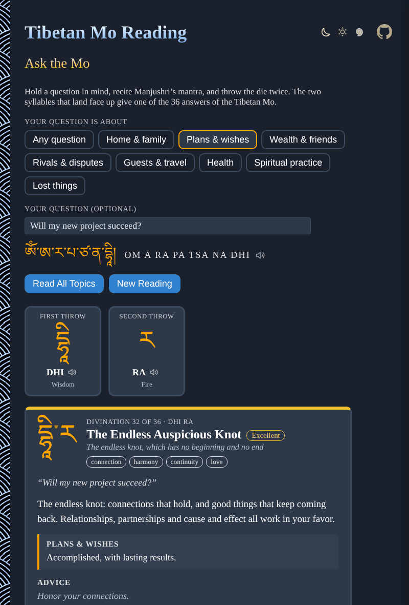

# Tibetan-Mo-Reading

Ask a question and throw the Mo die, right in your browser: a Tibetan Mo divination with the six syllables of Manjushri's mantra and the 36 answers of Jamgön Mipham's Mo. No sign-up and no libraries.

- [Ask the Mo](https://evoluteur.github.io/tibetan-mo-reading/)
- [About Mo](https://evoluteur.github.io/tibetan-mo-reading/about.html)
- [The 36 divinations](https://evoluteur.github.io/tibetan-mo-reading/mo/): one page per divination, with its omen, meaning, answer by question, symbol and advice

[](https://evoluteur.github.io/tibetan-mo-reading/)

## What it does

*Mo* is the Tibetan word for divination. Choose what your question is about, write it down if you like, recite the mantra (click the speaker icon to hear it), and throw the die twice. The two syllables that land face up, in order, give one of 36 divinations. The app shows its name, its omen, its meaning, the answer for your kind of question, a line of advice and a practice. "Read All Topics" shows the answer for every area of life at once.

The questions follow the areas of life a Mo manual answers, in modern wording:

- **Any question** (the divination as a whole)
- **Home & family**, **Plans & wishes**, **Wealth & friends**, **Rivals & disputes**
- **Guests & travel**, **Health**, **Spiritual practice**, **Lost things**

## The die

The Mo die has no numbers. Its six faces carry the six syllables of Manjushri's mantra, OM A RA PA TSA NA DHI, each commonly read with an element:

| Syllable | Tibetan | Element | Stands for |
| -------- | ------- | ------- | ---------- |
| A | ཨ | Space | openness, room, a fresh start |
| RA | ར | Fire | energy, heat, light and visibility |
| PA | པ | Water | calm, nourishment, feeling and peace |
| TSA | ཙ | Wind | movement, breath, news and change |
| NA | ན | Earth | stability, property, the body and growth |
| DHI | དྷཱི | Wisdom | clarity, intelligence and blessing |

The die is a 3D CSS cube that tumbles and lands on a random face; each throw has the same one-in-six chance for every syllable.

## The 36 divinations

Six first throws by six second throws give 36 divinations, from A A, [The Stainless Sky](https://evoluteur.github.io/tibetan-mo-reading/mo/1-the-stainless-sky.html), to DHI DHI, [The Jeweled Banner of Victory](https://evoluteur.github.io/tibetan-mo-reading/mo/36-the-jeweled-banner-of-victory.html). Each has an omen:

- **Excellent** (14) and **Good** (14): the auspicious signs, among them the eight auspicious symbols of Tibetan Buddhism (parasol, golden fish, lotus, conch, endless knot, wheel, victory banner and vase).
- **Caution** (4) and **Difficult** (4): the inauspicious ones, among them the four *maras*, the classic obstacles of the Buddhist path.

Each divination has its syllables, name, image, keywords, a meaning, an answer for each of the eight question areas, a line of advice and a suggested practice. The syllables and the names and order of the divinations follow Mipham's Mo. The meanings, answers, advice and practices were written for this app, in the spirit of the tradition, and no translation text is reproduced. A reading is a mirror for your own judgment, not a verdict.

## Hear the mantra

Click a speaker icon to hear the mantra or a syllable spoken aloud. It uses your browser's built-in speech voice, so there are no audio files and the voice depends on your device. Browsers without speech support simply do not show the icon.

## Divination pages

Every divination also has its own static page (`mo/1-the-stainless-sky.html` ... `mo/36-the-jeweled-banner-of-victory.html`), plus a page listing all 36 (`mo/index.html`), so each one can be found, shared and indexed on its own. They are generated from the same data as the app:

```
npm run build
```

This runs [scripts/build-mo-pages.js](https://github.com/evoluteur/tibetan-mo-reading/blob/main/scripts/build-mo-pages.js), which reads [js/mo-data.js](https://github.com/evoluteur/tibetan-mo-reading/blob/main/js/mo-data.js) and the notes on each symbol in [scripts/mo-extra.js](https://github.com/evoluteur/tibetan-mo-reading/blob/main/scripts/mo-extra.js), and rewrites the pages, `sitemap.xml` and `robots.txt`. It only needs Node. Re-run it after editing either file and commit the result.

## How it is built

The app itself is plain HTML, CSS and JavaScript, with no dependencies and no build step. Just open `index.html`. (The only build step is the optional one above that regenerates the static pages.)

- The Tibetan syllables are text, shown with [Noto Serif Tibetan](https://fonts.google.com/noto/specimen/Noto+Serif+Tibetan) from Google Fonts, falling back to the Tibetan fonts that ship with macOS and Windows.
- All the syllable, divination and question data lives in [js/mo-data.js](https://github.com/evoluteur/tibetan-mo-reading/blob/main/js/mo-data.js), and the app logic in [js/mo.js](https://github.com/evoluteur/tibetan-mo-reading/blob/main/js/mo.js).
- The spoken words are respelled the way they are pronounced in the `SAY` list at the top of [js/speech.js](https://github.com/evoluteur/tibetan-mo-reading/blob/main/js/speech.js), so a syllable that sounds wrong on your device is a one-line fix.
- Three color themes (dark, light and blue) are shared with my other projects (copied from [omg-themes](https://github.com/evoluteur/omg-themes)), and the theme, your question and your last reading are remembered in the browser's local storage.

Tibetan-Mo-Reading is open source at [GitHub](https://github.com/evoluteur/tibetan-mo-reading) with MIT license.

Had fun browsing the app? [Buy me a coffee by becoming a sponsor](https://github.com/sponsors/evoluteur).

You may also be interested in my other divination projects [I-Ching-Reading](https://github.com/evoluteur/i-ching-reading) ([demo](https://evoluteur.github.io/i-ching-reading/)), [Tarot-Reading](https://github.com/evoluteur/tarot-reading) ([demo](https://evoluteur.github.io/tarot-reading/)) and [Rune-Reading](https://github.com/evoluteur/rune-reading) ([demo](https://evoluteur.github.io/rune-reading/)). For more mystic arts as small web apps, see [Esoterica](https://evoluteur.github.io/esoterica.html).

Copyright (c) 2026 [Olivier Giulieri](https://evoluteur.github.io/).
